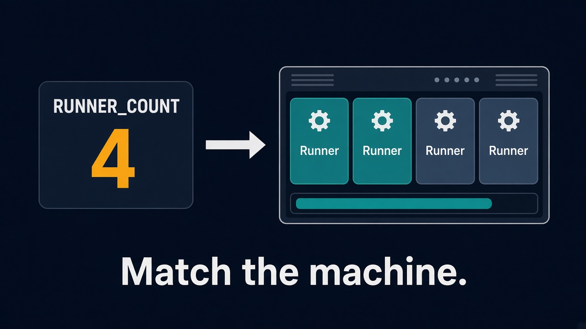
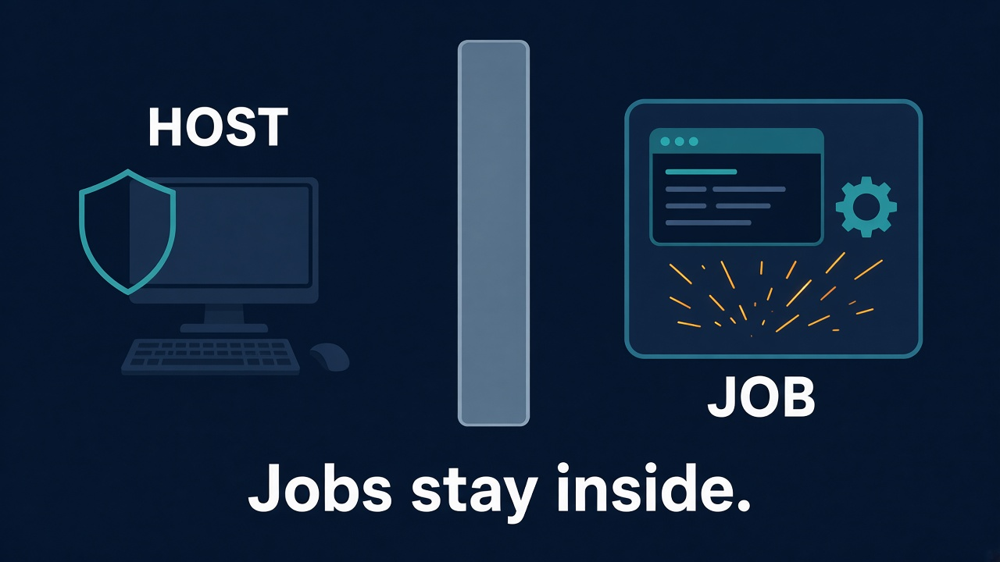
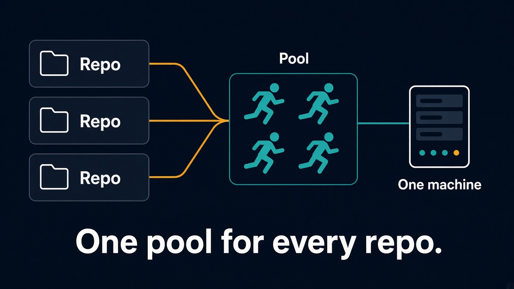

# A runner pool sized to the machine

GitHub-hosted runners are easy until the queue gets long, the job needs your network, or the minutes start to add up. This repository turns one computer you already have into a pool of self-hosted runners for a whole organization.

You set how many runners that machine should carry. One command writes a Compose file with that many containers. Each container registers itself, picks up jobs, and keeps its own workspace.

The runners use [myoung34/github-runner](https://hub.docker.com/r/myoung34/github-runner/).

## Size the pool to the hardware



`RUNNER_COUNT` is the only number you change. Four quiet cores might mean four runners. A build server with room to spare might mean twelve. Run the generator again and Compose creates the extra containers, names, and directories. Nothing is copied by hand.

## Keep the job off the host



The runner, the job, and the work files live in a container. The host does not grow a permanent Actions install, and yesterday's build tools do not stay behind on the desktop. Each runner has its own work directory and its own saved registration, so two jobs cannot overwrite each other.

The container mounts the Docker socket so a workflow can build images. That socket can also control the Docker engine, so point the pool only at workflows you trust. Do not send untrusted pull requests to these runners.

## One pool for every repository



The pool registers once, on the organization. Any repository in that organization can use it:

```yaml
runs-on: [self-hosted, docker]
```

GitHub sends the job to an idle runner. You do not install a separate runner for each repository.

## What else you get

- The same `.env` drives Windows, macOS, and Linux. `gen-compose.cmd` and `gen-compose.sh` write the same Compose file.
- A restart keeps the registration. The runner does not vanish from GitHub every time Docker stops.
- After registration, the personal access token is removed from the environment the job can read.
- Lower the count and the extra containers stop. Raise it when the machine can take more work.

## Start

Create a classic personal access token with the **admin:org** scope. The short token on GitHub's "New runner" page will not work, and checking only "Self-hosted runners" returns 403. The exact clicks are in [GUIDE.md](GUIDE.md).

```sh
cp .env.example .env
```

Set `ACCESS_TOKEN` and `ORG_NAME`, then:

```sh
./gen-compose.sh
docker compose up -d --remove-orphans
docker compose logs -f github-runner-1
```

On Windows, run `gen-compose.cmd` instead of `./gen-compose.sh`.

The runner is ready when the log prints `Listening for Jobs`.

`docker-compose.yml` is generated for your machine. It is not stored in this repository. Change `.env`, run the generator again, then `docker compose up -d --remove-orphans`.

## Configuration

| Variable | Role |
| --- | --- |
| `ACCESS_TOKEN` | Personal access token, used only to register the runners |
| `ORG_NAME` | Organization slug from the GitHub URL |
| `RUNNER_COUNT` | How many containers to create |
| `RUNNER_NAME_PREFIX` | Names become `runner-1`, `runner-2`, and so on |
| `LABELS` | Extra labels. The default custom label is `docker` |

The containers are Linux, even when the host is Windows. A job that needs `runs-on: windows` needs a Windows runner.

## License

[MIT](LICENSE)
